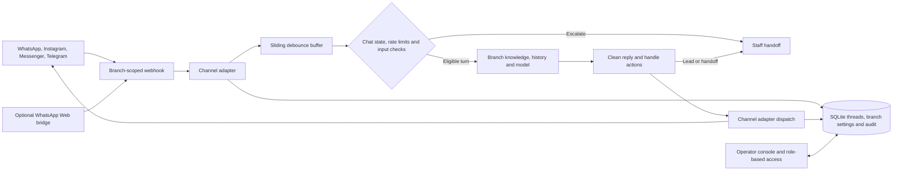

# Omnichannel AI Gateway

A branch-aware messaging gateway for hospitality teams that handles customer inquiries across WhatsApp, Instagram, Messenger, and Telegram from a single operator console.

The backend normalizes channel payloads, groups consecutive messages, and builds replies from the receiving branch's knowledge and conversation history. Staff can review threads, manage branch knowledge and access, and take over conversations that need a person.

## Architecture and message pipeline



The POST route `/webhook/{channel}/{branch_id}` parses messages with the channel adapter and stores inbound turns before buffering. The debounce key combines the branch, channel, and customer ID. The buffer runs in the backend process. Branch-specific context and prior messages feed the model router after the input checks. The application uses SQLite for its live database. The Docker Compose file also defines Redis and optional PostgreSQL services.

## Local setup

Use Python 3.10+. Node.js 18+ and Chromium are needed for the optional WhatsApp Web bridge.

```powershell
python -m venv .venv
.\.venv\Scripts\python.exe -m pip install -r requirements.txt
Copy-Item .env.example .env
```

Before the first start, replace the example `JWT_SECRET_KEY` and `INITIAL_ADMIN_PASSWORD`, set an admin email, and configure the model and channels you intend to use. The initial admin settings are used when seeding an empty database.

```powershell
Set-Location backend
..\.venv\Scripts\python.exe -m uvicorn main:app --host 127.0.0.1 --port 8000
```

Open `http://127.0.0.1:8000/` and sign in with the seeded admin account. The backend exposes status at `/api/health`. For the optional bridge, run `npm --prefix bridge install` and `npm --prefix bridge start` from the repository root, then pair the test account. Set `DEFAULT_BRANCH` to the branch the bridge should use.

| Configuration | Where it matters |
| --- | --- |
| `JWT_SECRET_KEY`, `INITIAL_ADMIN_EMAIL`, `INITIAL_ADMIN_PASSWORD` | Operator authentication and initial administrator |
| `LLM_PROVIDER`, `LLM_MODEL`, `LLM_API_KEY` | Model-backed reply generation |
| `DATABASE_PATH`, `DEBOUNCE_SECONDS` | Local database file and initial message grouping window |
| Channel tokens and account IDs | Channel-specific settings in the environment template |
| `BRIDGE_API_URL`, `DEFAULT_BRANCH` | Optional WhatsApp Web bridge and its target branch |

The GET webhook route handles provider challenge verification. Review POST request authentication and the included proxy configuration before exposing the service to a public endpoint. Keep bridge session data, the SQLite file, and logs private. [Environment template](.env.example) · [Compose configuration](docker-compose.yml) · [Deployment examples](deployment/)

## Code map and verification

| Component | Responsibility |
| --- | --- |
| [API and webhook routes](backend/main.py) | Inbound routing, operations, and customer reply pipeline |
| [Channel adapters](backend/adapters/) and [optional bridge](bridge/index.js) | Payload normalization and transport |
| [Debounce buffer](backend/debounce.py) and [model router](backend/llm_router.py) | Message aggregation and branch-aware generation |
| [Authentication](backend/auth.py), [database](backend/database.py), and [operator UI](frontend/) | Role checks, local state, and staff workflows |
| [Tests](backend/tests/) | Adapter, authorization, debounce, and integration coverage |

From `backend/`, run `..\.venv\Scripts\python.exe -m pytest tests/test_adapters.py tests/test_debounce.py` for focused adapter and buffering checks.
